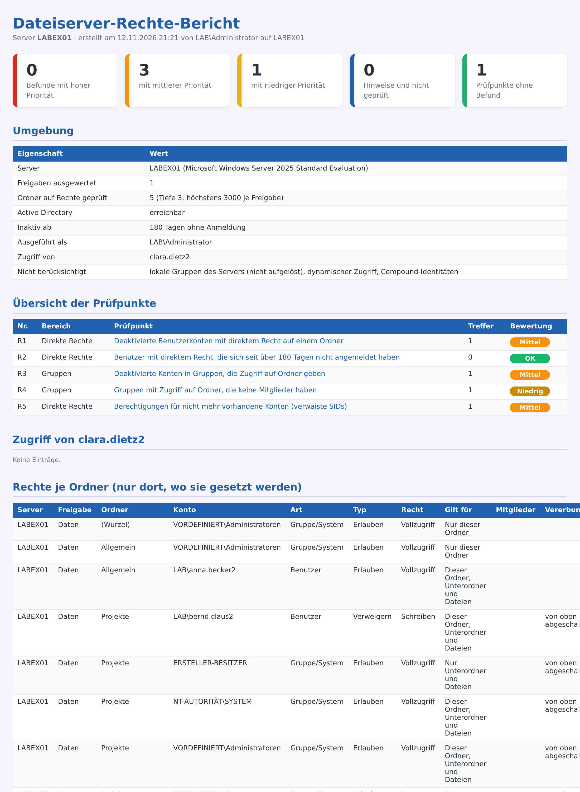
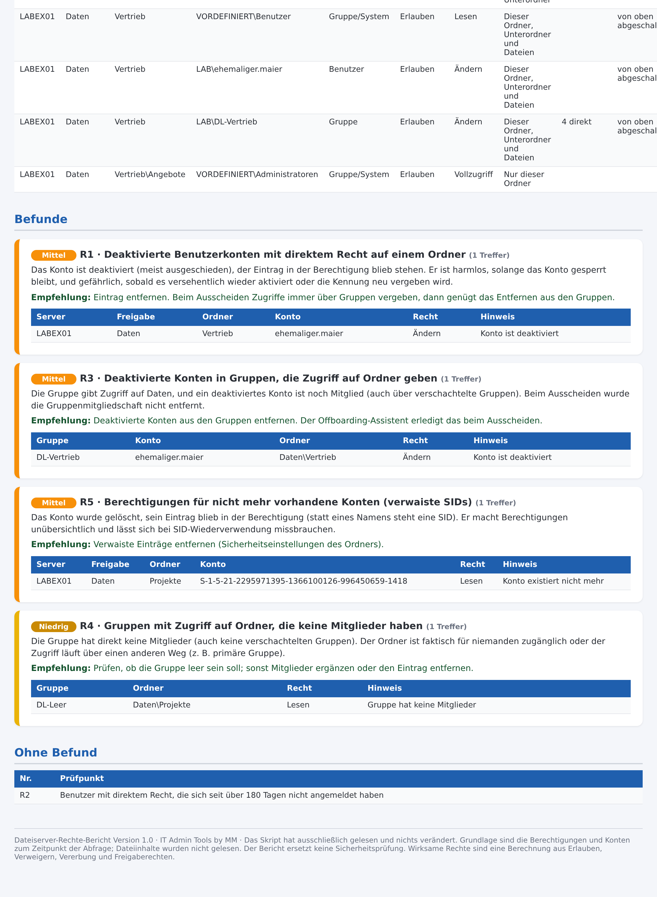

# Dateiserver-Rechte-Bericht – PowerShell-Skript: wer hat Zugriff auf den Dateiserver, und was passt nicht mehr

PowerShell-Skript, das zeigt, wer auf Windows-Dateiservern Zugriff hat: deaktivierte Konten mit Rechten, leere Gruppen, verwaiste Einträge und das wirksame Recht je Benutzer. Ergebnis: ein übersichtlicher HTML-Bericht auf Deutsch oder Englisch.

**Dieses Verzeichnis enthält kein Skript, nur Bilder der Funktionen.** Die Vollversion gibt es hier:

➜ **[Vollversion auf Gumroad](https://mueller86.gumroad.com/l/ijrkb)** · **[Vollversion auf Etsy](https://www.etsy.com/listing/4616706194)** · **[alle Skripte im Shop](https://www.etsy.com/shop/ITAdminToolsbyMM)**

Alle Bilder stammen aus einer Testumgebung mit erfundenen Daten.

## Übersicht und Kennzahlen

Kennzahlen im Kopf und alle Prüfpunkte auf einen Blick, nach Dringlichkeit bewertet.

## Ein Befund mit Erklärung und Empfehlung

Jeder Befund mit Erklärung, Empfehlung und den betroffenen Objekten.

## Weitere Befunde

Die Befunde im Detail.

## Eckdaten

- 8 Prüfpunkte, nur lesend, HTML-Bericht auf Deutsch oder Englisch (`-Language de|en`)
- Windows PowerShell 5.1 (in Windows 10/11 und Windows Server ab 2016 enthalten)
- Am genauesten direkt auf dem Dateiserver mit Administratorrechten; weitere Server per -Server über CIM/WinRM und die administrativen Freigaben (C$)
- Für die Auswertung der Konten und Gruppen: Rechner in der Domäne (Abfrage über das Verzeichnis von Windows, das Active-Directory-Modul ist nicht nötig)

<!-- querverweis:anfang -->
## Alle Skripte und Vorlagen

Übersicht aller Prüfskripte und Vorlagen: **[github.com/jackyno7](https://github.com/jackyno7)**

Vollversionen:

- Active Directory Prüfbericht: [Etsy](https://www.etsy.com/listing/4588853943) · [Gumroad](https://mueller86.gumroad.com/l/fcneoc)
- Domänencontroller-Gesundheitsbericht: [Etsy](https://www.etsy.com/listing/4593087246) · [Gumroad](https://mueller86.gumroad.com/l/bseljr)
- DNS- und DHCP-Bericht: [Etsy](https://www.etsy.com/listing/4593096270) · [Gumroad](https://mueller86.gumroad.com/l/sthgh)
- Kerberos- und Altlasten-Check: [Etsy](https://www.etsy.com/listing/4593092377) · [Gumroad](https://mueller86.gumroad.com/l/zptvct)
- Berechtigungsbericht Active Directory: [Etsy](https://www.etsy.com/listing/4593113568) · [Gumroad](https://mueller86.gumroad.com/l/xyjmdr)
- GPO-Bericht: [Etsy](https://www.etsy.com/listing/4593129111) · [Gumroad](https://mueller86.gumroad.com/l/wdosl)
- Anmelde- und Sperrbericht: [Etsy](https://www.etsy.com/listing/4593157082) · [Gumroad](https://mueller86.gumroad.com/l/ztktaaq)
- Rechner-Inventar aus Active Directory: [Etsy](https://www.etsy.com/listing/4593088535) · [Gumroad](https://mueller86.gumroad.com/l/zzycdd)
- Dateiserver-Bericht: [Etsy](https://www.etsy.com/listing/4612420692) · [Gumroad](https://mueller86.gumroad.com/l/wbbwj)
- Dateiserver-Rechte-Bericht: [Etsy](https://www.etsy.com/listing/4616706194) · [Gumroad](https://mueller86.gumroad.com/l/ijrkb)
- Windows-Rechnerbericht: [Etsy](https://www.etsy.com/listing/4616020701) · [Gumroad](https://mueller86.gumroad.com/l/wmhfk)
- Exchange-Postfachbericht: [Etsy](https://www.etsy.com/listing/4614916333) · [Gumroad](https://mueller86.gumroad.com/l/gkdllj)
- Exchange-Kalenderrechte-Bericht: [Etsy](https://www.etsy.com/listing/4614799790) · [Gumroad](https://mueller86.gumroad.com/l/iabfb)
- Exchange-Nachrichtenverfolgung: [Etsy](https://www.etsy.com/listing/4614785975) · [Gumroad](https://mueller86.gumroad.com/l/msria)
- Active Directory Prüfskript-Paket: [Etsy](https://www.etsy.com/listing/4611942401) · [Gumroad](https://mueller86.gumroad.com/l/awzjtc)

Vorlagen und Checklisten (Notfallplan, Backup, Passwortrichtlinie, Onboarding, Homeoffice, Netzwerk-Dokumentation): [Etsy](https://www.etsy.com/shop/ITAdminToolsbyMM) · [Gumroad](https://mueller86.gumroad.com)
<!-- querverweis:ende -->

## Hinweise

- Bei der Ausarbeitung wurden KI-Werkzeuge unterstützend eingesetzt; Inhalte und Skripte wurden fachlich geprüft und im Testlab getestet.
- Nutzung auf eigene Verantwortung.

---

### English

PowerShell script that shows who has access on Windows file servers: disabled accounts with permissions, empty groups, orphaned entries, and the effective permission per user. Result: a clear HTML report in German or English. This repository contains screenshots only. Full version: https://mueller86.gumroad.com/l/ijrkb

<!-- querverweis-en:anfang -->
#### All scripts and templates

Overview of all check scripts and templates: **[github.com/jackyno7](https://github.com/jackyno7)**

Full versions:

- Active Directory Audit Report: [Etsy](https://www.etsy.com/listing/4588853943) · [Gumroad](https://mueller86.gumroad.com/l/fcneoc)
- Domain Controller Health Report: [Etsy](https://www.etsy.com/listing/4593087246) · [Gumroad](https://mueller86.gumroad.com/l/bseljr)
- DNS and DHCP Report: [Etsy](https://www.etsy.com/listing/4593096270) · [Gumroad](https://mueller86.gumroad.com/l/sthgh)
- Kerberos and Legacy Check: [Etsy](https://www.etsy.com/listing/4593092377) · [Gumroad](https://mueller86.gumroad.com/l/zptvct)
- Active Directory Permissions Report: [Etsy](https://www.etsy.com/listing/4593113568) · [Gumroad](https://mueller86.gumroad.com/l/xyjmdr)
- GPO Report: [Etsy](https://www.etsy.com/listing/4593129111) · [Gumroad](https://mueller86.gumroad.com/l/wdosl)
- Logon and Lockout Report: [Etsy](https://www.etsy.com/listing/4593157082) · [Gumroad](https://mueller86.gumroad.com/l/ztktaaq)
- Computer Inventory from Active Directory: [Etsy](https://www.etsy.com/listing/4593088535) · [Gumroad](https://mueller86.gumroad.com/l/zzycdd)
- File Server Report: [Etsy](https://www.etsy.com/listing/4612420692) · [Gumroad](https://mueller86.gumroad.com/l/wbbwj)
- File Server Permissions Report: [Etsy](https://www.etsy.com/listing/4616706194) · [Gumroad](https://mueller86.gumroad.com/l/ijrkb)
- Windows Computer Report: [Etsy](https://www.etsy.com/listing/4616020701) · [Gumroad](https://mueller86.gumroad.com/l/wmhfk)
- Exchange Mailbox Report: [Etsy](https://www.etsy.com/listing/4614916333) · [Gumroad](https://mueller86.gumroad.com/l/gkdllj)
- Exchange Calendar Permissions Report: [Etsy](https://www.etsy.com/listing/4614799790) · [Gumroad](https://mueller86.gumroad.com/l/iabfb)
- Exchange Message Tracking: [Etsy](https://www.etsy.com/listing/4614785975) · [Gumroad](https://mueller86.gumroad.com/l/msria)
- Active Directory Check Script Bundle: [Etsy](https://www.etsy.com/listing/4611942401) · [Gumroad](https://mueller86.gumroad.com/l/awzjtc)

Templates and checklists (emergency plan, backup, password policy, onboarding, home office, network documentation): [Etsy](https://www.etsy.com/shop/ITAdminToolsbyMM) · [Gumroad](https://mueller86.gumroad.com)
<!-- querverweis-en:ende -->
